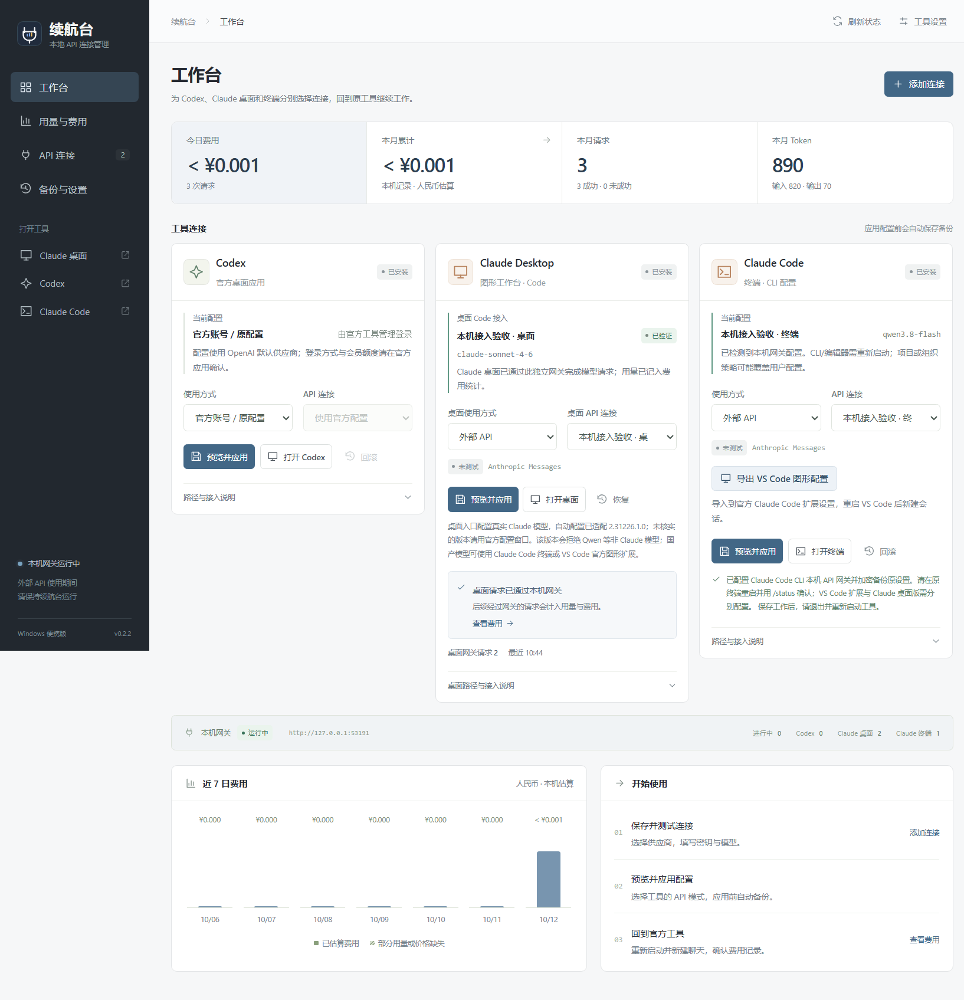
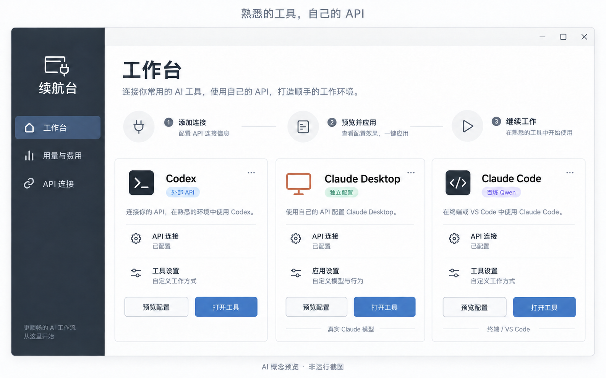
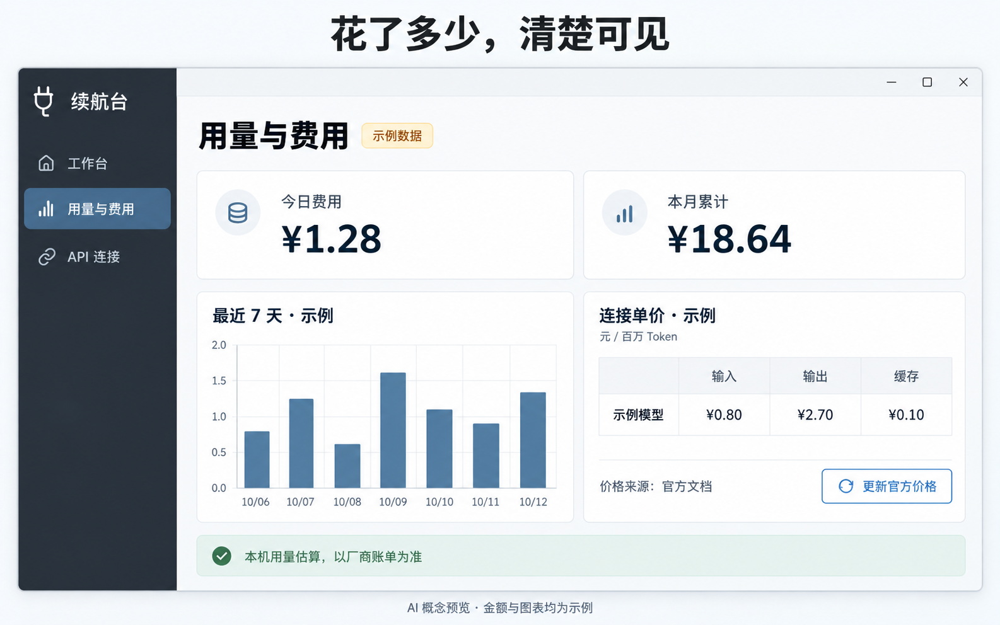
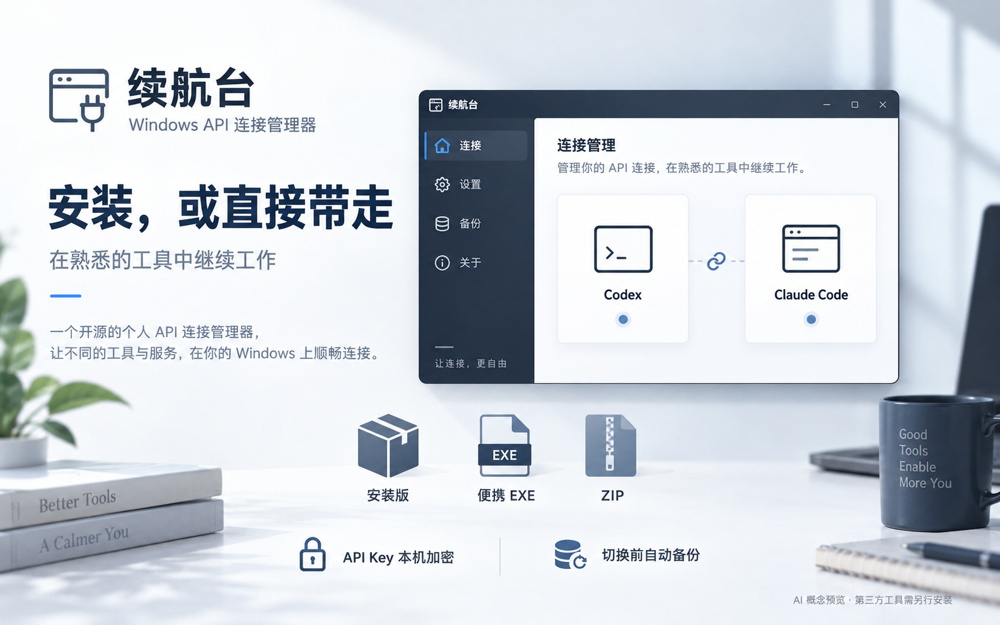

# 续航台 0.2.3

Codex 桌面与 Claude Code 的 API 连接伴侣。继续在原来的工作台编辑、聊天和处理项目，续航台负责连接、路由、费用统计与配置恢复。

## 下载与运行

**普通用户请到 [GitHub Releases 下载最新版](https://github.com/firewildgod/continuation-workbench/releases/latest)**，展开 Assets，选择下面一种程序包。GitHub 的「Code → Download ZIP」是源码，不是安装包。

- `Continuation-Workbench-0.2.3-portable.exe`：Windows x64 单文件便携版。
- `Continuation-Workbench-0.2.3-x64.zip`：解压后运行 `续航台.exe`。
- `Continuation-Workbench-0.2.3-setup.exe`：安装向导，可创建桌面快捷方式。

发行程序内置运行环境，不需要另装 Node.js 或 Python。首次使用见 [安装指南](docs/INSTALL.zh-CN.md)；官方 Codex、Claude 和 VS Code 的安装入口见 [官方工具说明](docs/OFFICIAL-TOOLS.zh-CN.md)。



截图是 0.2.2 本机隔离模拟接入验收，0.2.3 沿用相同功能界面；不是用户账单或厂商桌面实测。

## AI 产品概念预览

以下三张图片由 AI 生成，展示产品设计与发行形式，**不是运行截图或接入验证**。实际界面以发行程序为准；费用图的金额、单价和图表均为示例。上方本机 fixture 截图记录的是软件运行验收，与这些概念图分开展示。







图片用途与生成提示词见 [预览素材说明](assets/previews/README.md)。第三方工具需另行安装；图中的 Claude Desktop 入口使用真实 Claude 模型，百炼 Qwen 对应 Claude Code 终端或 VS Code 扩展。

## 便携版与升级

便携数据保存在程序旁的 `data`。关闭窗口会收进托盘；外部 API 模式下需要保持续航台运行。退出托盘程序会停止本机网关。

从 0.1.1 升级时，等模型请求结束，从旧程序托盘退出，将新 EXE 放到原目录，保留 `data` 后打开。不要同时运行两份使用相同网关端口的程序。复制到另一台电脑或另一个 Windows 用户时，要重新输入 API Key 并重新应用配置。

## 切到 API

1. 打开“API 连接”，选择供应商及计费方式，再选择 Codex 或 Claude Code。软件按工具匹配协议和地址，模型候选可选，也可以手动填准确模型 ID。
2. 输入模型 API Key。阿里云 AccessKey ID、普通百炼 Key 和包月 Token Plan Key 不是同一种凭据。
3. 保存并测试。测试是实际的小额模型请求，会记入本机用量；成功证明该请求通了，不保证整个工具链已验证。
4. 回“工作台”，选外部 API 和连接，预览配置。先保存工作并完全退出 Codex，再应用这份配置；原配置会加密备份。
5. 重新打开原工具，新建聊天确认模型。原有聊天可能保留原供应商，不能用旧聊天的模型显示推断新配置。

恢复时选择“官方账号 / 原配置”，预览并应用，然后重启原工具。若首次接管前已是其它 API，恢复的是那份原配置，不会凭空获得会员额度。

## Claude Code 与 Claude 桌面

工作台有独立的 **Claude Desktop** 与 **Claude Code 终端** 卡片。终端版合并用户 `settings.json`，保留原有权限、hooks 和其它配置，并映射主模型、小模型与子 Agent。

VS Code 扩展：应用 Claude API 路由后导出配置片段，将 `claudeCode.environmentVariables` 合并到当前 Profile 的用户设置，再重启编辑器。不要覆盖整份设置。

Claude 桌面使用独立的用户级第三方推理配置和网关路由。桌面卡可预览、加密备份后应用、打开原应用、恢复原配置；应用前先保存任务并完全退出 Claude 桌面。配置会影响该应用的 Chat、Cowork、Code；不会读取或更改会员登录凭据。实际成功请求后才显示「已验证」，模型目录检查不算实际接入验收。

自动配置已按本机 Claude `2.31226.1.0` 的程序结构核实；其它版本引导使用官方配置窗口，不盲写未知格式。该版本会拒绝 Qwen、DeepSeek 等非 Claude 模型。国产模型继续使用终端或 VS Code 官方图形扩展，不通过伪造 Claude 模型名绕过检查。桌面入口可接真实 Claude 模型的 API；支持协议不能等同于支持所有模型。见 [桌面接入指引](docs/claude-desktop-guide.md) 与 [版本兼容性核对](docs/claude-desktop-compatibility.md)。

## 费用统计

- 今日、本月人民币估算；按北京时间汇总。
- 近 7 日趋势、连接分布、成功与失败调用、输入/输出/缓存 Token 明细；后台保留 30 日聚合数据。
- JSON / SSE 接口直接返回用量；不按字符数猜 Token。
- 每次请求保存单价快照，改价只影响后续请求。缓存输入从总输入拆分，reasoning 不重复加价。
- 缺少用量或单价显示“未计价”；部分记录可计价时显示已知小计，不把未知费用当成零。
- 导出 CSV 报表，保留未知标记与单价来源。

北京百炼普通按量的 Qwen3.8 Flash / Max 会自动补入内置公开价。点击「连接单价」右上角的「更新官方价格」，即可从官方模型文档联网核对并保存最新参考价，不消耗模型 Token。表格显示价格来源与核对时间；断网或无法可靠识别价格时保留原价。手动报价默认不被覆盖，单个连接可选择「使用官方价格」恢复跟随。

目前自动报价仅覆盖上述模型与已识别的北京普通接口。Max 的两种缓存读取价格不同，统一用量字段无法区分时仍标记未计价。套餐、其它模型、地域和自定义转发端点继续保留手动设置。更新价格只影响后续调用。

统计只覆盖经过本机网关的请求及本软件的连接测试，不含会员额度、其它电脑或旧版本历史调用。赠额、折扣、阶梯、工具额外收费和套餐扣减以供应商账单为准。预算是提醒目标，不会达到目标后自动停止请求。

## 本地与隐私

只监听 `127.0.0.1` 的鉴权网关；供应商密钥使用 Windows 系统加密。公开状态、配置预览和无密钥备份不输出供应商 Key。

费用账本保存在 `data/usage-ledger.jsonl`，只存时间、连接、模型、结果、Token 与单价，不保存提示词、模型回答、项目文件内容或密钥。请求按所选地址发送给供应商。本软件没有费用自动上传或后台遥测。

发布包仅包含程序代码和静态资源，不带开发机器的 `data` 或账号资料。安装包尚未购买 Windows 代码签名证书，发行目录提供 SHA-256 校验值。

## 开发与验收

```powershell
npm ci
npm run typecheck
npm run build
npm test
npm run package
```

普通用户 UI 与真实接入测试使用独立 `.qa` 数据和配置路径，不能对全局官方配置做验收写入。日志与截图不进入安装包。详见 [更新说明](docs/release-0.2.3.md)。

公开源码按允许文件清单导出，提交前运行 `node scripts/check-public-source.cjs`。发行目录保护检查：`node scripts/verify-release-guard.cjs`。开发与贡献流程见 [贡献指南](docs/CONTRIBUTING.zh-CN.md)。

## 开源许可

续航台采用 [MIT License](LICENSE)，第三方许可见 [THIRD_PARTY_NOTICES.md](THIRD_PARTY_NOTICES.md)。程序本身免费，模型 API 由用户自行购买和承担实际用量费用。

仓库提供可自行启用的 [GitHub Actions 模板](docs/github-workflows/README.md)。当前发行包在发布前于 Windows 本机完成构建和验收；模板不等于已经启用的自动构建。

续航台是独立工具，不是 OpenAI、Anthropic 或任何模型供应商的官方产品。
